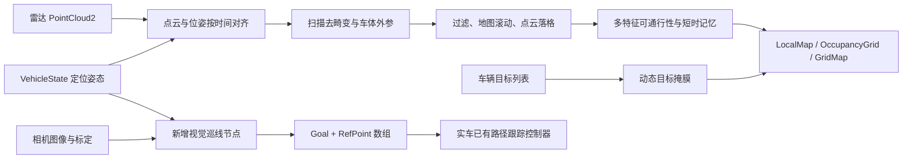

# 实车工程阅读与接口说明

本文依据已补齐的 `YHS_cuda_drivable/src` 正式源码、消息定义、launch、启动脚本及 `devel` 生成文件，解释实车可通行区域模块，并说明新的视觉巡线节点应如何接入。新节点的安装、配置和运行步骤见本目录 `README.md`。

## 1. 先确认这份工程包含什么

工程当前已经包含 `src/`、`build/`、`devel/`、启动脚本和日志。本文以正式源码为准，不再用 `.history` 的旧版本代替当前实现。`devel/lib/drivable_area_detection/clear_test` 也存在，但现有二进制是否与当前源码完全匹配，仍需在目标 ROS/CUDA 环境中重建或核对。

主要文件如下；下文简称“节点文件”“核心文件”等：

| 简写 | 正式文件 | 内容 |
| --- | --- | --- |
| 节点文件 | `../YHS_cuda_drivable/src/drivable_ros_ws/src/drivable/src/dr_detect.cpp` | ROS 订阅发布、位姿同步、点云去畸变、主循环 |
| 核心文件 | `../YHS_cuda_drivable/src/drivable_ros_ws/src/drivable/src/drivable_detect.cpp` | 点云过滤、栅格滚动、可通行性计算与历史融合 |
| 头文件 | `../YHS_cuda_drivable/src/drivable_ros_ws/src/drivable/src/drivable_detect.h` | 核心类、栅格数据结构与缓冲区 |
| 启动文件 | `../YHS_cuda_drivable/src/drivable_ros_ws/src/drivable/launch/clean_drivable.launch` | 当前点云源、同步模式、地图和外参参数 |
| CUDA 核函数 | `../YHS_cuda_drivable/src/drivable_ros_ws/src/drivable/src/cuda_kernels.cu` | 积分图、局部方差、风险累加和 CPU 调用封装 |
| 构建入口 | `../YHS_cuda_drivable/src/drivable_ros_ws/src/drivable/CMakeLists.txt` | `clear_test` 与 `cuda_kernels` 的编译、依赖和链接 |

消息包和支撑库的分工：

| 源码目录 | ROS 包名 | 作用 |
| --- | --- | --- |
| `src/cav_msgs` | `cav_msgs` | `VehicleState`、`Control`、`Gpybm`，车辆状态和控制协议 |
| `src/LocalMap_msg` | `LocalMap_msgs` | `LocalMap`、`LocalMap_Element`，局部可通行格子输出 |
| `src/xperception_msgs` | `xperception_msgs` | 目标、单传感器目标列表、多传感器目标列表 |
| `src/perception_ros_msg` | `perception_ros_msg` | 另一套目标、自由空间、车道和路沿等消息 |
| `src/grid_map` | 多个 `grid_map_*` 包 | 多层栅格容器、ROS 转换、过滤、RViz 显示等支撑库 |
| `src/drivable_ros_ws/src/drivable` | `drivable_area_detection` | 本文重点讲解的实车点云处理节点 |

`src/drivable_ros_ws` 是嵌套目录，业务包最终名称仍由其 `package.xml` 决定。`LocalMap_msg` 目录名与 `LocalMap_msgs` 包名也不同，写 ROS 类型时应使用包名。

其他文件的作用：

- `.catkin_tools/profiles/default/build.yaml` 声明源码目录为 `src`，输出目录为 `build/devel`。
- `.catkin_tools/profiles/default/packages/*/package.xml` 是构建时保存的包描述，能证明包名和声明依赖。
- `build/cav_msgs/cmake/cav_msgs-genmsg-context.py` 记录了消息生成环境；其中路径指向 `/opt/ros/noetic`，因此这里对应的是 ROS 1 Noetic 工程。
- `build/` 和 `devel/` 包含原机器的绝对路径 `/home/yhs/user_shaobing/YHS_cuda_drivable`。复制目录后不应直接复用旧 CMake 缓存；正式运行前应在目标环境重新配置构建。
- `1.txt` 到 `4.txt` 是运行输出，不是数据集。它们能帮助查看耗时和同步日志，不能替代点云、图像、标定或 rosbag。
- `framework.svg` 是架构图，可辅助阅读，但代码中的实际调用关系优先于图和注释。
- `.history` 是编辑历史，只适合比较版本；当前点云源、同步机制和障碍记忆已与其中一些快照不同。

当前 `VehicleState.msg` 和两种感知 `Object.msg` 均已存在。仍未找到相机驱动及标定、`Goal` 所在的正式消息包、`Goal` 消费者和底盘路径跟踪控制器；目录中的独立 `Goal.msg/RefPoint.msg` 不等于一个已经能被 ROS 导入的消息包。

## 2. 这套代码在实车系统里负责哪一段

核心任务是把激光雷达点云转成局部可通行性地图。它回答的是“附近哪些地面更适合行驶”，并不直接识别地上的引导线，也没有在当前业务源码中生成 `Goal.refPath` 或油门转向指令。



图中最后三项是新增巡线节点的接入位置。原激光雷达地图可供系统继续使用，但不能把一张可通行栅格图直接当成摄像头照片输入视觉巡线算法。新增巡线节点输出参考路径，底层跟踪控制器仍负责将路径转换为车轮动作。

## 3. ROS 节点如何接收、缓存和处理数据

### 3.1 启动入口和节拍

节点文件 `main()` 在第 1384 行调用 `ros::init(..., "drivableArea")`。启动文件实际启动 `drivable_area_detection` 包中的 `clear_test` 可执行程序，并把节点名称覆盖成 `ground_point_cloud`。因此在实车上寻找节点时，不能只搜索源码里的 `drivableArea`。

主循环在第 1465 行设置 `ros::Rate loop_rate(10)`，每次循环依次：

1. `ros::spinOnce()` 处理已经收到的消息回调。
2. 默认等待新 `VehicleState` 到来，再从点云缓存取出配对帧，执行 `lidarmappedCB(paired_cloud, &pending_state)`；关闭 `pose_driven_sync` 时才由新点云直接触发处理。
3. 有新目标列表时执行 `read_vehCB(veh_msg)`。
4. 发布 `LocalMap` 和占据栅格，清除更新标志。
5. 等待下一个循环。

这表示**目标主循环为 10 Hz**，并不保证所有话题实际都是 10 Hz，也不表示每一次地图发布都有新点云。点云处理超过 100 ms 会产生告警；应在真实运行时测量话题频率和延迟。

### 3.2 输入话题

| 当前启动配置的话题 | 消息类型 | 使用内容 | 证据 |
| --- | --- | --- | --- |
| `/vehicle/vehicle_state` | `cav_msgs/VehicleState` | 时间、UTM 位置、姿态、横摆角速度 | 节点文件 `read_stateCB()` 与第 1468 行附近 |
| `/lio_sam/deskew/cloud_deskewed` | `sensor_msgs/PointCloud2` | 上游 LIO-SAM 去畸变点云 | `clean_drivable.launch` 的 `lidar_topic`；订阅位于第 1476 行附近 |
| `/cav_vehicle_list` | `xperception_msgs/ObjectListCombined` | 目标位置、尺寸、朝向 | 第 1480 行附近 |

**源码参数默认值**是 `/rslidar_points`，但 launch 已覆盖为 `/lio_sam/deskew/cloud_deskewed`；接车排查时要以实际启动参数为准。LIO-SAM 节点本身不在本工程提供的源码中，需要实车已有定位链路发布这个话题。

`/percept_topic` 的订阅是被注释掉的代码，不能视为已接通。构建声明 `cv_bridge` 依赖，也不能证明存在相机图像订阅；业务节点中没有 `sensor_msgs/Image` 输入。`grid_map_ros` 库的图像转换函数和单元测试也不是相机驱动。

点云和目标列表回调先保存消息，主循环再统一计算。默认同步模式额外保留最多 10 帧点云；定位回调维护历史位姿并记录一个待处理定位状态。它不是把所有传感器数据无条件逐条排队计算。

### 3.3 时间同步为什么必要

一辆车转弯时，图像、点云和定位即使只相差几十毫秒，投影后的边界也可能明显偏移。当前节点提供两条同步路线。

**默认的定位驱动配对：** `pose_driven_sync=true` 时，`takeCloudForState()` 从缓存中选择时间戳不晚于定位原始时间戳的最后一帧点云，要求二者相差不超过 250 ms，然后直接使用该定位的 `x/y/z/heading`，不再进行位置插值或 GPS 航向外推。命中后删除该帧及更早点云，防止重复处理。

这一做法试图解决“定位晚于输入点云产生，最新点云却被错误配上前一帧航向”的问题。它依赖上游定位的产生方式：定位确实要对应刚才那帧雷达，而且当定位使用输出时刻打戳时，其处理延迟应小于一帧点云周期。**250 ms 容差仅约束差值，不足以证明关联身份。** 上游延迟超过一帧时仍可能错配，不能把这条经验关联直接用于独立相机流。

**可选的点云驱动插值：** `pose_driven_sync=false` 时，按点云采样时刻查询 `VehicleState`：

- 保留最多 200 条、约 2 秒的位姿历史。
- 相差不超过 2 ms 可直接匹配。
- 在两条定位之间，对位置线性插值，对航向按最短角差插值。
- 插值区间不得超过 150 ms；缓冲边缘允许至多 120 ms 的有限外推。
- 未找到符合条件的定位时，不应把不同时间的数据强行视作同步。

跨越 `+π/-π` 时不能直接对两个角度做普通平均，`lerpAngleRad()` 使用角度归一化处理了这个问题。新增视觉节点同样必须用**图像采样时刻**的定位来把路径投到世界坐标，不能用发布时刻的新位置替代。

在插值路线中，`heading_from_gps=false` 时按定位时间使用航向；设为 `true` 才进行 `heading_latency_sec × yaw_rate` 的航向前推。配对路线直接使用配对航向，不调用这一步。

`read_stateCB()` 还可从进入历史缓冲的时间戳中扣除 `state_latency_sec`，而默认配对使用扣除前的原始时间戳。当前 launch 将两个时间偏移设为 0。不能把补偿选项当成通用增稳开关，应先查看 `Stamp probe` 和 `Lidar pose sync [paired]` 日志确认真实时间语义。

### 3.4 `VehicleState` 的完整字段分组

正式定义位于 `src/cav_msgs/msg/VehicleState.msg`，包含以下分组：

- 消息时间、车辆 ID/名称/类型和车辆状态。
- RTK 状态、序列号、秒/纳秒时间、GPS 经纬度和海拔。
- `RTK_gps_UTM_x/y/z`，明确为米；RTK 的 ENU 速度和局部速度。
- 核心车辆位置 `x/y/z`，单位米；核心局部速度 `speed_x/y/z`，单位 m/s。
- `heading/pitch/roll` 明确为弧度，`yaw_rate` 为 rad/s；加速度为 m/s²。
- 车长宽高、轴距，均为米；挡位、线控使能、车辆模式。
- 油门、制动、转向反馈与接管/超时状态，电池和故障状态。

可通行节点读的是核心 `x/y/z/heading`，不是直接使用经纬度。新增巡线节点可用 `speed_x` 获得车体前向速度；不要把 `RTK_linear_ENU_vx` 当作始终沿车头的速度。消息里有字段不等于实车发布端一定正确填充，应通过一段静止与前进数据确认。

## 4. 坐标系：最容易造成实车路径错误的部分

### 4.1 车体、ENU 和 UTM

从 `transform_rotation()`、`filterPC()` 和 `Loc_mapPB()` 的实际计算可以确认，所见代码按以下约定工作：

- 车体平面：`x` 向前，`y` 向左。
- 世界平面：ENU 对齐，`x` 对应东向、`y` 对应北向。
- `VehicleState.heading` 被直接送入 `sin/cos`，代码期望弧度，并以东向为零、逆时针为正。
- `VehicleState.x/y` 在该节点中被作为 UTM 平面位置使用。

对车体局部点 `(x_b, y_b)`，世界点是：

```text
x_w = vehicle_x + cos(heading) * x_b - sin(heading) * y_b
y_w = vehicle_y + sin(heading) * x_b + cos(heading) * y_b
```

这里说明的是**这段代码期望的输入语义**，并不能证明上游定位驱动实际发送的语义正确。如果上游用“正北为零、顺时针为正”的 GPS 航向，必须在明确的接口层转换。地图看起来转了 90° 或左右镜像，往往是约定不一致而非识别算法失效。

### 4.2 `camera_init` 不是相机光学坐标

节点把可视化点云和栅格的 `frame_id` 写成 `camera_init`。从 `publishPoseTF()` 的实现看，这个名字实际表示**以当前栅格锚点为原点、与 ENU 对齐的局部坐标系**：

```text
camera_init → base_link → lidar_link
```

`base_link` 平移量是 UTM 位置减去栅格锚点。锚点随车辆移动而变化，因此 `camera_init` 也不能不加判断地当作固定全局坐标系。更不能因为它名字里有 `camera` 就把它当成相机的 `optical_frame`。

`/cav_local_map` 元素的 `ct_x/ct_y` 则是“锚点 + 局部格心”的 UTM 绝对坐标。两类输出中虽然描述的是同一片路面，但数值参考原点不同。

### 4.3 雷达外参

当前启动文件设置：

```text
lidar_offset_x = -0.6 m
lidar_offset_y =  0.0 m
apply_lidar_extrinsic = true
```

这里参数表示“车辆中心在雷达坐标下的位置”，代码注释与计算约定为 `p_body = p_lidar - offset`。`-0.6 m` 表示雷达位于车辆中心前方 0.6 m，而不是车辆中心前方安装了一个 `-0.6 m` 的雷达。必须先确定参数代表哪一个方向的变换，不能只凭正负号调试。

相机也需要它自己的内参和车体外参；雷达的 `-0.6 m` 不能复制为相机外参。

## 5. 从点云到可通行地图的完整逻辑

### 5.1 扫描去畸变

机械式雷达一帧中的点通常不是同一时刻采样。节点文件中的 `deskewCloud()` 寻找 `timestamp/time/t` 逐点时间字段，以有限的一阶匀速、匀角速度模型把各点补偿到统一参考时刻。

补偿同时考虑车辆平移、横摆旋转和雷达相对车辆中心的杠杆臂。直观上，车转弯时雷达还会围绕车辆中心走一段弧线，不能只给所有点乘一个相同的航向旋转矩阵。

**当前 launch 已使用 LIO-SAM 去畸变点云，因此 `deskew_enable=false`。** 这一配置避免对同一数据重复补偿。如果切回原始 `/rslidar_points` 并启用内部去畸变，应核对逐点时间字段；没有这些字段时，代码告警并回退为普通 PCL 转换。存在 `deskew_enable=true` 不代表补偿一定生效，要检查日志中的 `Deskew ON/OFF`、时间跨度和角速度来源。

### 5.2 点云过滤

`filterPC()` 移除 NaN 点，按车体前后左右范围裁剪，并排除车身附近矩形盲区及过高的点。对已经 ENU 对齐的输入，它先转回车体系判断 ROI，保证车身过滤范围随车头方向一致。

它还统计车前近地面平均高度；附近没有足够点时使用历史值，防止 NaN 污染地图。已有多帧缓存可进行体素下采样。

### 5.3 栅格滚动和历史对齐

`ini()` 根据 `floor(utm / grid_size) × grid_size` 得到落在网格线上的锚点。车辆移动后，历史地图按整数格平移，再写入当前点云。这比每帧任意移动地图原点更容易保持格心一致。

启动文件使用 `map_size=307`、`grid_size=0.1 m`，所以局部栅格边长是 30.7 m。`RANGE=40 m` 是点云过滤范围参数，不能把它解释成地图有 80 m 的宽度。

当前正式源码在 ENU/UTM 下只按平移滚动历史，没有旧快照中“航向变化超过约 3° 就清空历史”的分支。障碍时间记忆使用 `obstacle_ttl_sec`，当前 launch 为 5 秒。历史位置是否稳定首先依赖点云、定位和外参准确同步，延长记忆不能修复错误的坐标关联。

### 5.4 点云落格

`mapping()` 维护可选的点云历史，`movePC2Grid()` 把点分配到各个 `GRID_INFO`。每格记录点集、高度统计、平面性或可通行性等属性。

默认 `mapping_frame_num=1`，主要依赖当前帧及栅格历史。不能仅因为函数叫 `mapping` 就理解为进行了全局 SLAM 建图。

### 5.5 当前实际使用的多特征可通行性

节点文件第 1335 行调用的是 `compute_drivable_passability()`，实现位于核心文件第 673 行起。函数依次进行四步：

1. 对至少有 5 个点的格子做 PCA 平面估计，求坡度、点到平面的 RMS 粗糙度、高度分位差 `P95-P5` 和平面性。
2. 再计算与八邻域平均高度的差，补充台阶特征。
3. 对点不足的空洞格，尝试用附近高可通行性格子补全；障碍及其邻域受到保护。
4. 融合短时间障碍记忆，写回连续可通行度与占据代价。

各特征先通过分段线性函数归一化为 `[0,1]` 惩罚，再按权重相加：

| 特征 | 低惩罚起点 | 最大惩罚起点 | 权重 |
| --- | --- | --- | --- |
| 坡度 | 8° | 20° | 0.30 |
| 粗糙度 RMS | 0.015 m | 0.080 m | 0.24 |
| 高度分位差 | 0.030 m | 0.200 m | 0.16 |
| 八邻域高差 | 0.040 m | 0.180 m | 0.20 |
| 平面性比值 | 0.020 | 0.180 | 0.10 |

可通行分数约为 `1 - 加权惩罚`，越大越容易通行。空洞补全最多做四轮，主要使用分数至少 0.65 的邻居，目的是减少远处雷达线束间没有点造成的条纹。

输出到 `LocalMap` 时，`driveable_value` 保持 `[0,1]`，`driveable_index` 按 `value > 0.5` 二值化；输出占据代价约为 `100 × (1-value)`，限制在 1～99。

### 5.6 CUDA/CVaR 在哪里

核心文件保留了 `compute_cvar()`，它通过 `cuda_kernels.cu` 中的 `computeCVaRCUDAWrapper()` 计算风险层；旧 `make_final_decision()` 会调用它。然而**当前节点第 1326～1335 行附近把 `checkFlatness()`、`checkHeight()`、`make_final_decision()` 和 `checkUnocclusion()` 的调用注释掉了**。

CUDA 源文件现在是完整可读的。封装的执行顺序是：

1. 分配 GPU 输入和输出缓冲。
2. 上传 `elevation`，用 `conv3x3cov_step_cal` 计算局部方差，写回 `step`。
3. 逐层上传所选风险图，以 `16×16` 线程块和边缘共享缓存计算 3×3 邻域统计。
4. `conv3x3cov_accumulate` 按层累加 `weight × mean + weight² × variance × cvarFactor`。
5. 拷回 `CVaR` 图层，释放 GPU 缓冲。

`CVaRcal.cpp` 和 `CVaRcal_cuda.cpp` 还保留了另一套计算器实现，其中单格计算包含 `mu + sqrt(sigma²) × factor`；它与上述累加内核的公式并不相同。文件名相同概念不代表不同实现已经数学等价，重新启用前需要统一定义并比较数值结果。

因此必须分开两个结论：**构建会编译并链接 CUDA，当前活跃可通行性流水线没有调用 CVaR 支路。** `ini()` 每帧把 `CVaR` 清零，看到发布图层名不能推断它正在计算。CPU 循环虽然写有 OpenMP pragma，但包的 CMake 没有显式开启 OpenMP；应检查目标机器实际编译选项后再判断有没有并行执行。

## 6. 输出话题分别用来做什么

| 话题 | 类型 | 内容与注意点 |
| --- | --- | --- |
| `/cav_local_map` | `LocalMap_msgs/LocalMap` | UTM 格心、格子大小、可通行度；是较直接的业务输出 |
| `/drivable/occ_map` | `nav_msgs/OccupancyGrid` | 可通行度反向映射后的代价；带有该工程的显示方向约定 |
| `/drivable/Hei_map` | `nav_msgs/OccupancyGrid` | 高度归一化为灰度，主要用于可视化，不是占据概率 |
| `/drivable/filtered_point_cloud` | `sensor_msgs/PointCloud2` | 过滤后的点云，可检查投影与转弯拖影 |
| `grid_map` | `grid_map_msgs/GridMap` | 多层地图；不要默认所有命名层都在当前分支实时计算 |
| `/drivable/ground_point_cloud` | `sensor_msgs/PointCloud2` | 发布器存在，但所见活跃流程未调用对应输出函数 |

动态车辆列表会被画成扩大后的矩形掩膜，并把相关 `sub_map` 代价设为 100。这里还有一个值得后续核实的差别：`Loc_mapPB()` 取的是 `drivable_value_grid`，而目标掩膜直接改的是 `sub_map`。这两条发布路径没有在同一循环中统一回写，因此 `/cav_local_map` 与 `/drivable/occ_map` 的动态障碍结果不能视为完全一致。

## 7. 阅读中发现的限制与接口风险

这些结论针对当前正式源码，本次接口适配没有修改原实车工程：

1. **点云与定位配对带有上游假设。** 默认按“不晚于状态的最后一帧点云”关联；上游打戳和延迟变化时可能错配，不能仅凭 250 ms 容差认为同步可靠。
2. **未知不等于安全。** 点不足时的补全及历史基线可能把值抬至 0.6，而发布阈值是 0.5。下游不能把“分数高于阈值”理解为该格一定有新鲜、直接的地面观测。
3. **地图时间戳来源不完全一致。** `LocalMap` 使用检测帧时间，部分可视化输出使用全局最新 `timeRtk`；融合数据时应检查对应位姿，不要只比较发布接收时间。
4. **旧说明未必对应活跃分支。** 一些函数顶部注释仍列出已经注释的 `checkFlatness()` 等调用，理解流程时必须以函数体为准。
5. **几何约定需要消费者一起确认。** `Object.x/y` 在目标掩膜函数中直接减地图锚点，说明这段实现按全局位置解释它；其他注释却可能写成车体系。必须查看真实消息发布端来最终确认。
6. **构建配置存在需要核对的细节。** CMake 要求 CUDA，并把 C++ 标准设为 14；部分代码使用结构化绑定。旧缓存或编译器扩展可能掩盖兼容性问题，应在目标环境完整构建确认，不能凭已有二进制推断任意新机器均可编译。

### 7.1 两个启动脚本的实际作用

`drivable.sh` 是可通行节点启动器：写入 `~/launcher_logs`，加载固定的 `/home/jimmy/drivable/devel/setup.sh`，停止匹配到的 `rosbridge_websocket` 进程，然后执行 `roslaunch drivable_area_detection clean_drivable.launch`。迁移后应核对这个写死的工作空间路径；它并不会自动定位脚本所在目录。

脚本在加载环境前先检查 `roslaunch/rospack`，因此一个完全没有 source ROS 的终端可能提前退出。它用包含 `drivable` 的节点名判断注册，而 launch 把主节点叫 `ground_point_cloud`，所以这个检查还可能误报。

`visualizer.sh` 则负责重启 Nginx、调整 Conda 环境、启动 `rosbridge_server` 并打开 `http://localhost`，服务于原有浏览器可视化，不参与参考路径计算。该脚本写的是 `ROS_VERSION="melodic"`，而当前构建环境记录的是 Noetic；使用前要统一真实发行版。这两个脚本都会操作进程或服务，不能把它们当作纯粹的环境配置脚本顺手执行。

`clean_drivable.launch` 是本次审查的有效配置。另一个 `wild_cat_drivable.launch` 中 `map_size` 写为 `type="int" value="15-3"`，不是合法整数值，不应原样选作启动入口。

### 7.2 原工程构建依赖与新增巡线节点的区别

原工程的 `CMakeLists.txt` 构建 `cuda_kernels` 静态库，再把 `dr_detect.cpp`、`drivable_detect.cpp`、`CVaRcal.cpp`、`CVaRcal_cuda.cpp` 编进 `clear_test`。它依赖 ROS/catkin、PCL、Eigen、OpenCV、CUDA 和上述自定义消息包。

新的 Python 视觉巡线节点不需要为了识别图像而链接这个 CUDA 可通行节点；它需要 ROS 消息环境、图像处理依赖以及真实 `Goal` 消息包。两个节点可通过 ROS 并行存在，不应把原工程的所有编译依赖强加给视觉算法安装流程。

## 8. `Goal.msg` 与 `RefPoint.msg` 对新节点意味着什么

仓库根目录的两个文件确切规定了字段类型与大小写：

```text
Goal
  float64 timestamp
  int16 Estop
  bool Go
  int16 Signal
  RefPoint[] refPath
  int16 mode
  Object[] objects

RefPoint
  float64 t
  float64 x
  float64 y
  float64 v
  float64 heading
  float64 cr
  float64 left_width
  float64 right_width
  int16 turning_flag
```

`refPath` 是路径点数组，不能发布一个普通 `nav_msgs/Path` 到同名话题就认为协议一致。`Estop`、`Go`、`Signal` 的大小写也必须保持一致。

但 `.msg` **没有**规定以下内容：

- 消息属于哪个 ROS 包、控制器订阅哪个话题。
- `x/y` 是 UTM 绝对坐标还是车体局部坐标。
- `heading` 使用度还是弧度、零方向和正方向是什么。
- `t` 是绝对时间还是相对路径起点的时间。
- `left_width/right_width` 的具体控制语义。
- 控制器多久未收到新路径会超时、收到 `Go=false` 如何处理。

根目录与 `YHS_cuda_drivable/` 中的两份 `Goal.msg/RefPoint.msg` 内容一致，但均未进入这里任何包的 `add_message_files()`。`Goal` 中写的是不带包前缀的 `Object[]`，即应该解析为 **Goal 自己所在消息包的 Object 类型**。

工程已经有两种正式 `Object.msg`：`xperception_msgs/Object` 包含位置、尺寸、航向、速度、置信度等标量；`perception_ros_msg/Object` 则由 `CoreInfo`、标志和 `SupplementInfo` 组成。它们不是同一个协议，也没有证据证明任意一个就是 `Goal.objects` 所要求的类型。即使 `objects=[]`，ROS 生成消息和计算类型校验时仍需要确定依赖类型；不能随意复制一种 Object 或造空类型来冒充。

尤其要注意：可见 `cav_msgs` 构建清单只有 `Control.msg`、`VehicleState.msg` 和 `Gpybm.msg`，没有 `Goal.msg`。所以不能凭输入来自 `cav_msgs`，就假定输出一定叫 `cav_msgs/Goal`。

新节点应加载实车已安装的真实消息类型，按两个文件规定校验字段，并把上述未定义的语义放入显式配置。对没有感知依据的道路左右宽度，不应捏造为已识别的边界。

## 9. 为什么参考路径不能简单每帧重发

视觉识别可以连续处理图像，给控制器的路径更新可以有独立节拍。两者不是同一个频率：

1. 每帧识别候选线，结合前一帧线路和车辆运动保持路线身份。
2. 将可信的线路转换成有米制尺度的车体路径，并对接世界坐标。
3. 保留一段连续、足够长的参考路径；只有新路径可靠且达到更新间隔才替换。
4. 车辆前进后修剪已经经过的部分，不能把同一串旧局部坐标反复当作当前路径发布。
5. 当前可信可见距离不足时，应减速或停止；不能为了凑足路径长度无约束延伸。

路径点间距、路径长度、速度和更新周期要一起设置。假设车速为 `v`、更新周期为 `T`、控制与通信总延迟为 `τ`、可用减速度为 `a`，可信路径至少需要覆盖车辆在 `T+τ` 内的前进距离和刹停距离，并留出余量：

```text
需要覆盖的距离 ≳ v × (T + τ) + v² / (2a) + 余量
```

这只是设计检查关系，不是实车制动能力的测量结果。频率必须与控制器的路径超时设置匹配；不能一方面把路径发布降得很低，另一方面让底层仍按更高频率等待心跳。

## 10. 接车前最少需要确认的信息

从实车运行环境中取得下面几项即可完成接口配置，而不必把整个服务器环境复制过来：

| 所需信息 | 为什么必须有 |
| --- | --- |
| 图像话题、编码、分辨率、时间戳和相机标定 | 原工程没有相机输入；像素转换成米制地面点需要标定 |
| `VehicleState` 实际发布时的坐标、时间和有效字段 | 完整定义已经有了，还需确认发布端确实遵守这些约定 |
| `Goal` 的真实包名、话题及完整依赖消息 | 保证 ROS 类型、序列化和 MD5 一致 |
| 控制器关于 `x/y/heading/t/cr/width` 和超时的约定 | `.msg` 字段本身不能替代控制接口协议 |

在车辆已有 ROS 环境里，可先用这些只读命令检查：

```bash
rostopic list
rostopic type /vehicle/vehicle_state
rosmsg show cav_msgs/VehicleState
rostopic echo -n 1 /vehicle/vehicle_state
rostopic hz /vehicle/vehicle_state
```

再把下面的占位符替换成实际结果：

```bash
rostopic type <图像话题>
rostopic hz <图像话题>
rostopic info <控制器路径话题>
rosmsg show <真实包名>/Goal
rosmsg md5 <真实包名>/Goal
rosmsg show <真实包名>/RefPoint
```

先使用录制数据或仅可视化输出核对坐标、尺度、左右方向、时序和失效停止，再接通控制器。当前已能完整阅读可通行区域主体和相关消息，剩余的是相机输入、Goal 所属协议及消费者约定、实际 ROS 联通和车辆验证；不能用代码级验证代替这些实车接口检查。
